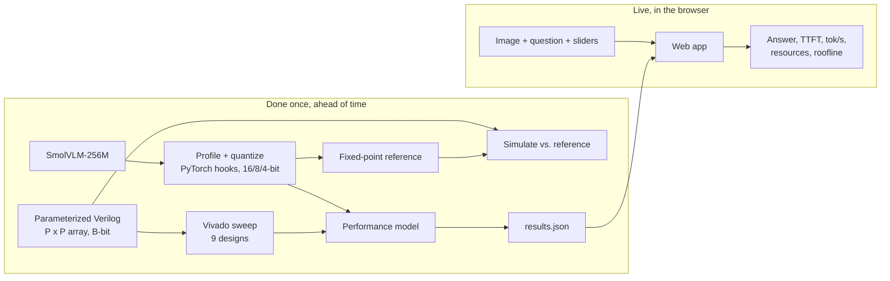

# EdgeVLM Lab

An interactive toolkit that shows how a small vision-language model (VLM) runs
on edge hardware. A user shows the model an image, asks a question, and watches
the answer stream in. Then they change hardware design choices (number
precision, multiplier array size, image size, memory bandwidth) and see how
accuracy, time to first token (TTFT), tokens per second, FPGA resources, power
and energy respond.

The hardware numbers come from our own parameterized Verilog accelerator,
verified against a fixed-point reference and synthesized in Vivado for a
Zynq-7020.

> **Status: early development (Fall 2026).** The systolic-array RTL, its
> testbench, a cycle-accurate model, the quantization reference and a first
> performance model are in place. See [Roadmap](#roadmap).

## The idea in one sentence

**More multipliers make the model start answering sooner, but they don't make
it talk faster. Fewer bits do.**

- **Prefill is compute-bound.** Before the first word, the vision encoder
  processes every image patch, then the language model processes the image and
  prompt tokens together. That is large matrix multiplication, so a bigger
  array cuts TTFT.
- **Decode is memory-bound.** Each new word re-reads every language-model
  weight while doing little math. Extra multipliers sit idle; 8-bit or 4-bit
  weights move fewer bytes and raise tokens per second.

## How it fits together



## Accelerator

`hw/rtl/systolic_array.v` is a P x P **output-stationary systolic array** of
signed B-bit multiply-accumulate PEs (`hw/rtl/mac_pe.v`):

- Each cycle, one column of A and one row of B enter the array. Row *i* of A is
  delayed *i* cycles and column *j* of B is delayed *j* cycles, so `A[i][k]` and
  `B[k][j]` meet in PE(*i*, *j*) at cycle *k + i + j*.
- Each PE adds its product into a local accumulator and passes its operands
  right and down.
- A P x P output tile takes **K + 2P - 2 cycles** for an inner dimension K;
  `busy` falls when results are final.
- `P`, `B` and the accumulator width `ACC` (default 2B + 8) are parameters.

Planned design sweep on the Zynq-7020 (53,200 LUTs, 220 DSP blocks):

| | 4 x 4 (16 MACs) | 8 x 8 (64 MACs) | 16 x 16 (256 MACs) |
| --- | --- | --- | --- |
| 16-bit | design 1 | design 2 | design 3 (exceeds 220 DSPs) |
| 8-bit | design 4 | design 5 | design 6 |
| 4-bit | design 7 | design 8 | design 9 |

## Repository layout

```
hw/rtl/           Verilog: mac_pe, systolic_array
hw/tb/            Self-checking testbench (random matrices vs. behavioral multiply)
hw/model/         Cycle-accurate Python model of the array (golden timing + values)
hw/scripts/       Testbench runner, Vivado synthesis sweep -> results.json
model/            VLM profiling (PyTorch hooks) and fixed-point quantization reference
perf/             Roofline performance model (TTFT, tokens/s, energy)
web/              React + Vite front end (coming)
docs/             Diagrams and reports
```

## Quick start

```bash
pip install -r requirements.txt

# Cycle-accurate model self-test (numpy only)
python hw/model/systolic_model.py

# Quantization error at 16/8/4 bits on random data
python model/quant_ref.py

# First-order TTFT / tokens-per-second table (placeholder workload numbers)
python perf/perf_model.py

# RTL testbench across array sizes and precisions (Vivado simulator)
python hw/scripts/run_tb.py            # or: --sim iverilog

# Synthesis sweep (Vivado, Zynq-7020) -> results.json
python hw/scripts/run_sweep.py

# Profile the real model (needs: pip install torch transformers pillow)
python model/profile_smolvlm.py --image docs/example.jpg

# Figures: per-cycle dataflow of the array, and the 9-design TTFT vs. tokens/s tradeoff
python hw/model/plot_dataflow.py          # -> docs/dataflow.png
python perf/plot_perf.py                  # -> docs/tradeoff.png

# Waveforms: dump a VCD and open it in GTKWave (or use Vivado's waveform viewer)
iverilog -g2012 -DDUMP -P tb_systolic_array.P=4 -P tb_systolic_array.K=8 -o sim.vvp hw/rtl/*.v hw/tb/tb_systolic_array.v
vvp -n sim.vvp && gtkwave waves.vcd
```

## Status

| Piece | State |
| --- | --- |
| Cycle-accurate array model | Working: matches numpy matmul for 18 configurations, latency K + 2P - 2 |
| Quantization reference | Working (per-tensor and per-channel symmetric) |
| Performance model | Working with placeholder workload numbers |
| Systolic-array RTL + testbench | Passing in Icarus Verilog: all 9 (P, B) configs, plus K = 1, 64, 576 |
| Synthesis sweep scripts | Written; first Vivado run pending |
| VLM profiler | Written; first run pending |
| Softmax / LayerNorm units | Planned |
| Web app | Planned |

## Roadmap

**By Oct 25 (midterm):** SmolVLM running in PyTorch and in the browser; per-layer
profile; first 8- and 4-bit accuracy results; matrix-multiply engine passing
simulation against the reference; first TTFT estimate; site skeleton with one
working slider.

**By Dec 11 (final):** all 9 designs synthesized; performance model validated
against cycle-accurate simulation of one full-size layer; site with lessons and
Verilog export.

## Team

| Area | Owner |
| --- | --- |
| Hardware: accelerator RTL, verification, synthesis, performance model | Lucius Casertano |
| Model: profiling, quantization, accuracy benchmarks | Eryc Rodriguez |
| Website: React app, in-browser model, visualizations | Anh Tran |

Built for a graduate deep learning course at the University of Arizona (Fall 2026).
Model: [SmolVLM-256M-Instruct](https://huggingface.co/HuggingFaceTB/SmolVLM-256M-Instruct) (Apache 2.0).
